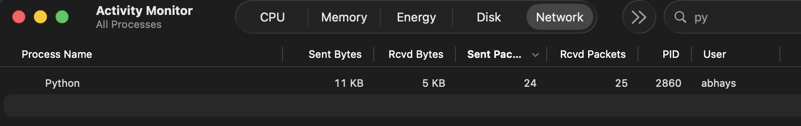
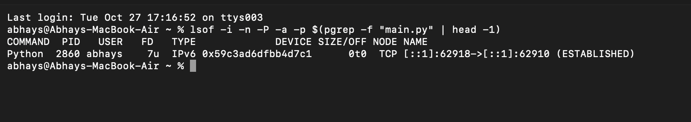

# US-17 / SR-2 — Network check

**Date:** 27 October 2026 · **Tester:** Abhay S · **Machine:** MacBook Air (macOS) · **Result:** PASS

**Method:** `python main.py` running with a YouTube playlist open; 10 voice commands given
(pause, resume, volume down, volume up, next, previous, pause, play, volume down, volume up).
Network use of the Python process was watched in Activity Monitor, and its open connections were listed with `lsof`.

| Measurement | Value |
|---|---|
| Python Sent Packets, start → after 10 commands | 4 → 24 (about 2 per command) |
| Python Sent Bytes, whole run including startup | 11 KB |
| Python network connections (`lsof -i`) | One: `[::1]:62918 -> [::1]:62910`, localhost only (Chrome's local driver) |

**Interpretation:** The only connection is to `[::1]`, the laptop itself, used to send the small
play/pause/next instructions to Chrome. Sending speech would need about 32 KB per second of audio
(30–60 KB per command); the whole run sent 11 KB. No audio leaves the device.
Chrome's own traffic is the YouTube video stream and is not part of the voice processing.

Automated evidence: `tests/test_us19_status_and_us17_local.py` (PR #44) runs the full command
pipeline with network connections blocked and checks that no audio is written to disk.

