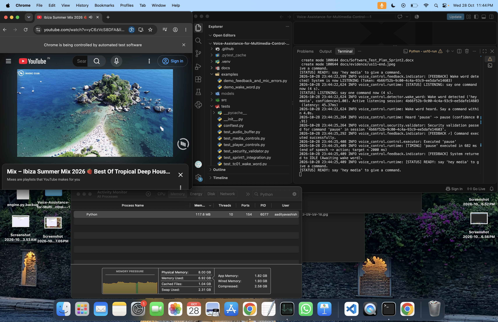
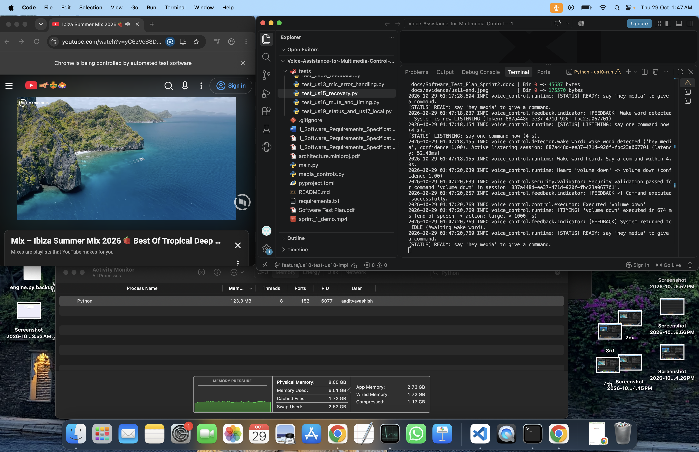

# Sprint 2 Test Log

**Project:** Voice Assistance for Multimedia Control
**Date:** 26 October 2026 (updated 27 October 2026)
**Tester:** Aarohi

## 1. Test Environment

- **Operating system:** Windows
- **Microphone:** Built-in laptop microphone
- **Browser:** Google Chrome 155.0.8059.85 (64-bit)
- **Application:** Python application running in the `.venv` virtual environment
- **Speech recognition:** Vosk offline backend by default
- **Vosk model:** `models/vosk-model-small-en-in-0.4`
- **Media player:** YouTube in the browser

## 2. Summary of Results

| Test / Requirement | Current status | Evidence / Remaining work |
|---|---|---|
| Full automated test suite | PASS | 190 passed, 0 failed; 11 warnings (27 October, after merging main) |
| US-08: Unsupported commands | Verified | First live test 5/5 rejected; re-test with 5 new phrases 5/5 rejected, no media action (27 October) |
| US-12: Unclear commands | Verified for observed test | Unclear speech rejected, no media action observed, application returned to IDLE |
| US-14: Media player error handling | Verified | Automated tests passed; failure path and all seven successful actions confirmed live (27 October) |
| US-20: Duplicate execution prevention | Verified | Automated one-command-per-wake-word and identical-audio replay tests pass; live microphone check passed on 27 October |
| SR-2: Local audio processing | Verified | Vosk configured as default; network check during 10 commands showed no outside connection and no audio-sized traffic (Abhay, 27 October, macOS) |
| TC-09 / NFR-1: Performance | Preliminary evidence available | Complete the planned performance test |
| NFR-2: Recognition reliability | PASS based on recorded results | 45 of 50 valid-command utterances succeeded (90%) |
| NFR-3: Availability | PENDING — 2-hour run by Aaditya (US-10, approved change D-5); 15-minute preliminary run passed | Requirement reduced from 8 hours to 2 hours with teacher approval (SRS v1.1, D-5) |
| NFR-4: First-time-user usability | PASS for observed sessions | Two first-time users issued working commands without a manual; tester 2 received a hint regarding the wake word (28 October); see Section 13 |
| US-09: Command feedback (Abhay) | Automated tests pass | `test_us09_feedback.py` passes (PR #34); live feedback tones seen in the live sessions above |
| US-13: Microphone error handling (Abhay) | Automated tests pass | `test_us13_mic_error_handling.py` passes (PR #34) |
| US-16: Microphone privacy / mute (Abhay) | Verified | `test_us16_mute_and_timing.py` passes (23 tests); live mute/unmute check passed on 26 October (see Section 17.2) |
| US-19: Listening status indicator (Abhay) | Automated tests pass | `test_us19_status_and_us17_local.py` passes (18 tests) |
| US-15: Recover from recognition errors (Aaditya) | Verified for observed live scenario | `test_us15_recovery.py`: 18 automated tests pass; live recognition-error handling and recovery without restart observed on 26 October. See Section 17.3 |
| US-17 / SR-2: Local voice processing (Abhay) | Verified | Automated checks pass; live network check PASS (see Section 10 and [docs/evidence/us17-network-check.md](evidence/us17-network-check.md)) |
| US-11 / NFR-1 / NFR-2: Accuracy and speed (Aaditya) | AWAITING EVIDENCE | Waiting for Aaditya's formal results (50 utterances; 7 commands × 5). Preliminary figures are in sections 9 and 11 |
| US-10 / NFR-3: Continuous availability (Aaditya) | PENDING — 2-hour run by Aaditya (US-10, approved change D-5); 15-minute preliminary run passed | See NFR-3 row above |
| US-18: Startup system check (Aaditya) | NOT STARTED | Due Wednesday 28 October |
| Deprecation warnings | Not blocking tests | 11 warnings related to NumPy 2.5 and `sounddevice.py` |

## 3. Automated Test Results

**Full test suite**

- Command: `python -m pytest tests/ -v`
- Result: **190 passed, 0 failed** (27 October, after merging `main`)
- Recorded duration: 12.44 seconds
- Warnings: 11 deprecation warnings originating from `sounddevice.py` related to NumPy 2.5.

**Targeted test results**

| Test selection | Result |
|---|---|
| Unclear, unrecognized and invalid commands | 6 passed, 161 deselected |
| Duplicate, replay and wake-word tests | 30 passed, 137 deselected |
| Media controls: `python -m pytest tests/test_media_controls.py -v` | 20 passed |
| Mute and timing test file | 23 passed |

These results establish that the recorded automated tests passed. They do not prove that every possible real-world audio input or browser state has been tested.

## 4. Live Voice-Command Tests

### 4.1 Wake-word detection

- **Command:** `hey media`
- **Expected result:** Application detects the wake word and enters the listening state.
- **Observed result:** Wake word detected with confidence 1.00; application entered `LISTENING`.
- **Status:** PASS for the observed test.

### 4.2 Supported commands

The earlier recorded live checks reported successful recognition and execution for the following commands:

| Command | Previously recorded response time | Observed result |
|---|---:|---|
| Play | 634 ms | Reported executed successfully |
| Pause | 620 ms | Reported executed successfully |
| Resume | 652 ms | Reported executed successfully |
| Next | 653 ms | Reported executed successfully |
| Previous | 626 ms | Reported executed successfully |
| Volume up | 613–657 ms | Reported executed successfully |
| Volume down | 619–645 ms | Reported executed successfully |

The measurements above are from earlier recorded attempts. They should not be treated as a complete performance test.

### 4.3 Additional live verification — 26 October

The following additional results were recorded during the live application session:

| Test | Observed result | Response time | Status |
|---|---|---:|---|
| Volume up | Recognized with confidence 1.00; security validation passed; command reported executed successfully | 688 ms | PASS for observed execution |
| Pause | Recognized with confidence 1.00; security validation passed; command reported executed successfully | 719 ms | PASS for observed execution |
| Unclear speech | Recognition error handled, rejection feedback emitted, and application returned to IDLE | Not recorded | PASS for observed error handling |

For volume up and pause, the application logged the response time from the end of speech to the action. Both were within their respective logged timing targets.

**Interpretation:** A successful execution message in the logs does not by itself establish that the visible YouTube playback state or volume changed. The visible results were checked separately; see the live verification in Section 7 (27 October).

## 5. US-08 — Reject Unsupported Commands

**Date:** 26 October 2026
**Method:** Live microphone test after activating the wake word `hey media`.

| Test phrase | Observed result | Status |
|---|---|---|
| Open Instagram | Recognized and rejected as unsupported | PASS |
| Take a screenshot | Recognized and rejected as unsupported | PASS |
| Send an email | Recognized and rejected as unsupported | PASS |
| Turn on the lights | Recognized as `turn on lights` and rejected as unsupported | PASS |
| Check the weather | Recognized and rejected as unsupported | PASS |

**Result:** 5/5 confirmed attempts passed. No unsupported action was executed during these attempts.

Some additional attempts returned `Speech was not understood`. These were inconclusive and were not counted as confirmed unsupported-command passes.

**Status of the first test:** Passed for the five listed live attempts. The phrases had been temporarily added to the recognizer's vocabulary for that test, so a re-test with new phrases was carried out (below).

### 5.1 Re-test with five new phrases — 27 October 2026

**Method:** Live microphone test after saying "hey media". The five phrases below were not used in the first test, and no phrase was taught to the recognizer.

| # | Phrase spoken | Observed result | Media action? | Status |
|---|---|---|---|---|
| 1 | open facebook | Rejected: "Speech was not understood"; error feedback logged; returned to IDLE | None | PASS |
| 2 | set an alarm | Same | None | PASS |
| 3 | what time is it | Same | None | PASS |
| 4 | call my mother | Same | None | PASS |
| 5 | open Netflix | Same | None | PASS |

**Note:** The Vosk grammar is closed, so out-of-vocabulary speech is rejected by the recognizer before the command mapper runs. All five attempts were rejected, logged, and caused no media action. Mapper-level rejection of recognized-but-unsupported text (for example "open netflix" and "send an email") is covered by the automated tests `test_unsupported_or_unclear_command_is_rejected` and `test_map_command_rejects_everything_else`.

**Result:** 5/5 passed. No unsupported phrase caused a media action.

**Status:** Verified.

## 6. US-12 — Handle Unclear Voice Commands

**Date:** 26 October 2026

| Test scenario | Observed result | Status |
|---|---|---|
| Unrecognized speech after wake word | Assistant displayed “Didn't catch that, please repeat” | PASS |
| Recognition error handling | `UnrecognizedCommandError` was handled and rejection/failure feedback was emitted | PASS |
| Session recovery | Application returned to `IDLE` | PASS |
| No unintended media action | No media action was observed during the live unclear-speech test | PASS for the observed test |

**Live test evidence:**

- The application detected `hey media` with confidence 1.00.
- The application prompted the user to repeat the unclear speech.
- The error handler processed `UnrecognizedCommandError`.
- Rejection/failure feedback was emitted.
- The application returned to `IDLE`.
- The user confirmed that no media action was taken during this test.

**Conclusion:** US-12 passed for the observed live scenario. Broader testing with different unclear phrases may still be useful.

## 7. US-14 — Media Player Error Handling

### Automated tests

- Command: `python -m pytest tests/test_media_controls.py -v`
- Result: **20 passed**
- The tests cover media-control success and failure behavior, including simulated disconnected browser sessions and volume limits.

### Error-handling evidence

- `next_track()` handles a simulated disconnected Selenium session, returns `False`, and displays a friendly error message.
- `previous_track()` handles a simulated disconnected Selenium session in the same way.
- Tests verify that technical exception details are not unnecessarily printed as user-facing error messages.
- A live disconnected-session path was previously exercised: the command failed safely, failure feedback appeared, and the system returned to `IDLE`.

### Live verification of successful actions — 27 October 2026

**Method:** Live microphone test with a YouTube playlist open in the Chrome window controlled by the application. Each command was spoken after "hey media", and the visible result in the browser was checked.

| Command | Expected visible result | Observed | Status |
|---|---|---|---|
| Play | Video starts playing | Video started playing | PASS |
| Pause | Video pauses | Video paused | PASS |
| Resume | Video continues | Video continued | PASS |
| Next | Switches to the next video | Switched to the next video | PASS |
| Previous | Returns to the previous video | Returned to the previous video | PASS |
| Volume up | Volume increases one step | Volume increased | PASS |
| Volume down | Volume decreases one step | Volume decreased | PASS |

**Conclusion:** All three US-14 criteria are covered. A failed operation is detected and gives an error indication (automated tests and the earlier live failure check). Success is never reported when an operation fails (the media functions verify the result before returning True). All seven successful actions were confirmed visibly.

**Status:** Verified: automated error-handling tests passed, and visible success behavior was confirmed live on 27 October.

## 8. US-20 — Prevent Duplicate Command Execution

**Automated evidence:**

- `test_one_command_per_wake_word` passed.
- `test_one_command_executes_only_once_per_wake_word` passed.
- `test_replayed_command_without_new_wake_word_is_ignored` passed.
- The selected duplicate, replay and wake-word test group passed: 30 passed, 137 deselected.
- The full project test suite passed: 190 passed, 0 failed, with 11 non-blocking deprecation warnings (27 October, after merging main).
- `test_new_wake_word_allows_next_command_after_session_ends` passed, confirming that a new wake word allows a separate command after the previous session ends.

| Scenario | Status |
|---|---|
| One command per wake-word session | PASS in automated tests |
| Command without a new wake word is ignored | PASS in automated tests |
| Session returns to IDLE after processing | PASS in recorded integration tests |
| Identical raw-audio replay cannot execute the same action twice | PASS in automated test (`test_identical_command_audio_replay_without_new_wake_word_is_ignored`) |

**Conclusion:** One-command-per-wake-word behavior and identical-audio replay protection pass in automated tests. See the 27 October live microphone verification in Section 17.1.

**Additional regression test — identical command audio replay**

- Test: `test_identical_command_audio_replay_without_new_wake_word_is_ignored`
- Result: PASS
- Verification: The same command audio bytes were replayed after the first command completed, without a new wake word.
- Assertions: The media action executed only once, exactly one result was recorded, and the session remained in `IDLE`.
- Integration suite: 62 passed (at the time this test was added).
- Full test suite at that time: 171 passed, 0 failed, 11 deprecation warnings. The latest full-suite result is 190 passed (Section 3).
- Limitation: This is a synthetic-audio integration test using a scripted transcriber; it does not replay recorded audio through the microphone.

**Conclusion:** Automated replay protection is verified for the tested scenario. Do not claim all possible duplicate replay scenarios are covered.

## 9. TC-09 / NFR-1 — Response-Time Performance

**Requirement:** Valid voice commands should execute within the specified 2,000 ms target. The application also logs tighter targets for particular commands.

### Recorded evidence

- Earlier live command measurements ranged from 613–673 ms.
- Additional live measurements were 688 ms for volume up and 719 ms for pause.
- The two additional measurements were within their respective logged targets.
- Timing-related automated tests passed.

Five earlier manual measurements were also recorded:

| Trial | Response time |
|---|---:|
| 1 | 1.84 seconds |
| 2 | 1.89 seconds |
| 3 | 2.00 seconds |
| 4 | 1.88 seconds |
| 5 | 1.68 seconds |

**Average:** 1.858 seconds (approximately 1.86 seconds).

Four of these five measurements were strictly below 2 seconds; one was exactly 2.00 seconds.

**Conclusion:** The preliminary results are encouraging, but the complete performance requirement remains pending until the planned measurement procedure is completed and its acceptance criteria are confirmed.

## 10. SR-2 — Local Audio Processing

**Requirement:** Raw audio is processed locally and is not transmitted off-device during normal operation.

### Evidence collected

- `src/voice_control/config.py` sets `recognizer_backend` to `vosk` by default.
- The configured model path is `models/vosk-model-small-en-in-0.4`.
- `Test-Path "models/vosk-model-small-en-in-0.4"` returned `True`.
- `main.py` defaults the command-line `--backend` argument to `vosk`.
- `main.py` calls `create_transcriber()` using the selected backend.
- The application started successfully with `python main.py`, and live wake-word and command recognition worked.

### Network-traffic check — 27 October 2026 (performed by Abhay, MacBook Air, macOS)

**Method:** The application was run with the offline Vosk backend and 10 voice commands were given. Network activity of the Python process was observed in Activity Monitor (Network tab), and its open connections were listed with `lsof -i -n -P -a -p <pid>`.

| Check | Observation |
|---|---|
| Activity Monitor, process "Python" | Sent packets rose from 4 to 24 over the 10 commands (about 2 per command), as reported by the tester. The final screenshot shows 24 sent / 25 received packets, about 11 KB sent and 5 KB received in total |
| `lsof` while running | The only connection was `[::1]:62918 -> [::1]:62910` (localhost, Chrome's local driver). No connection to any outside address |
| Expected traffic if audio were sent | Roughly 30–60 KB per command (tester's estimate); nothing of that size was observed |

**Evidence files:** [docs/evidence/us17-network-check.md](evidence/us17-network-check.md), `docs/evidence/us17-activity-monitor.png` and `docs/evidence/us17-lsof.png`.

**Limitations:** `lsof` is a single snapshot. The test ran on a macOS laptop, not the Windows test laptop. The starting packet count (4) is from the tester's notes and is not shown in the screenshots.

**Status:** PASS for the observed test. No outside connection and no audio-sized traffic were seen, consistent with local processing.

## 11. NFR-2 — Recognition Reliability

**Requirement:** Correctly recognize at least 90% of 50 valid-command utterances in a quiet room.

- Recorded successful utterances: 45 out of 50.
- Recorded success rate: 90%.
- Recorded unsuccessful utterances: 5.

**Status:** PASS based on the recorded 50-utterance test results.

## 12. NFR-3 — Availability

**Requirement:** Application remains running continuously for 2 hours without restarting. The original SRS requirement of 8 hours was changed to 2 hours with the teacher's approval (SRS v1.1, deviation D-5).

- Preliminary result: Application remained running and responsive for 15 continuous minutes without restart. This is only a preliminary run and does not satisfy the 2-hour requirement.

**Status:** PENDING — 2-hour run by Aaditya (US-10, approved change D-5); 15-minute preliminary run passed

## 13. NFR-4 — First-Time-User Usability

**Requirement (SRS NFR-4):** A first-time user shall be able to issue a working command without reading a manual, using only the 7 defined command words.

**Date:** 28 October 2026 · **Observer:** Aarohi · **Machine:** Windows laptop, built-in microphone

**Method:** Two first-time users controlled a YouTube playlist by voice with no manual. The observer recorded the commands each user issued, the results, the hints given and their comments.

| Item | Tester 1 | Tester 2 |
|---|---|---|
| First-time user | Yes | Yes |
| Commands issued (in order) | play, pause, next, volume up (twice), resume | play, volume down, previous, next (twice), pause |
| Result | All commands executed | All commands executed |
| Hint given | No hint or instructions provided | A hint regarding the wake word ("hey media") was given; tester 2 had not read the terminal instruction. |
| Comment | Overall experience was good | Overall experience was good |

**Observations:**
- One tester attempted functions outside the seven defined commands: playback speed, video quality, and autoplay. The application rejected these unsupported requests, as expected under US-08.
- Tester 2 initially needed a hint regarding the wake word. Both testers reported that the overall experience was good.
- Future work: requests for speed, quality, and autoplay control suggest possible additional commands.

**Status:** PASS for the two observed sessions. Both first-time users successfully issued working commands without a manual. Tester 2 received a hint regarding the wake word; this assistance is recorded above and should be considered when interpreting the usability result.

## 14. Warnings and Issues

- The full test run reported 11 `DeprecationWarning` messages from `sounddevice.py` related to NumPy 2.5.
- These warnings did not cause test failures.
- The full automated test suite completed successfully.
- Investigate the deprecation warnings separately; do not treat them as test failures.

## 15. Remaining Work

| Item | Current status | Next action |
|---|---|---|
| Automated project tests | PASS | Rerun before final merge or release |
| US-08 unsupported commands | Verified | None; retain both live test results |
| US-12 unclear commands | Passed for the observed live scenario | Test additional phrases if required |
| US-14 media error handling | Verified | None; retain the automated and live evidence |
| US-20 duplicate execution | Verified | None; retain the automated and live evidence |
| US-16 microphone mute | Verified | None; retain the live check (Section 17.2) |
| US-15 recovery from recognition errors | Verified for observed live scenario | Retain automated and live-check evidence; no repeat required for the observed scenario |
| US-11 accuracy and response time | Awaiting Aaditya | Record formal results (50 utterances; 7 commands × 5) |
| US-18 startup system check | Not started | Aaditya, due 28 October; record the result |
| TC-09 / NFR-1 performance | Preliminary measurements available | Complete the planned performance test |
| NFR-2 recognition reliability | PASS in recorded test | Retain the 45/50 evidence |
| NFR-3 availability | PENDING — 2-hour run by Aaditya (US-10, approved change D-5); 15-minute preliminary run passed | Aaditya completes the 2-hour run; record the result here |
| NFR-4 usability | PASS | None; retain the observation notes (Section 13) |
| SR-2 local audio processing | Verified | None; retain the network-check evidence |
| Deprecation warnings | Non-blocking warnings | Investigate separately if time permits |

## 16. Final Summary — 27 October 2026

- The latest full automated test run passed: **190 passed, 0 failed, with 11 deprecation warnings** (27 October, after merging `main`).
- Live Vosk startup, wake-word detection, and all seven commands were observed working at runtime.
- The live unclear-speech test handled the recognition error, returned to `IDLE`, and did not trigger a media action.
- US-08 is verified: the first live test passed 5/5, and the re-test with five new phrases passed 5/5 with no media action.
- US-14 is verified: automated error-handling tests passed and all seven successful actions were confirmed visibly on 27 October.
- US-20 is verified: automated regression tests pass (including identical-audio replay and acceptance of a new wake word), and the live microphone check passed on 27 October.
- Performance results are promising, but the full performance test remains pending.
- SR-2 is verified: Vosk is the default backend and Abhay's network check (27 October) showed no outside connection and no audio-sized traffic.
- US-16 is verified: automated tests pass and the live mute/unmute check passed on 26 October.
- NFR-3 remains PENDING until Aaditya completes the 2-hour run (approved change D-5).
- NFR-4 passed for the two observed sessions: both first-time users issued working commands without a manual on 28 October; tester 2 received a hint regarding the wake word (Section 13).
- The 11 deprecation warnings did not cause test failures.

**Overall assessment:** The automated test suite and the recorded live checks are encouraging. Do not mark any remaining item fully complete until its required evidence has been collected and documented.

## 17. Additional Live Verification Records

### 17.1 US-20 — Live Microphone Verification

**Date:** 27 October 2026

- Started the application using `python main.py`.
- Spoke the wake word followed by `play`; the command executed successfully.
- Repeated a command without saying the wake word again; no additional action occurred.
- Spoke the wake word again followed by `pause`; the command executed successfully.
- Confirmed that the application returned to IDLE after each executed command.

**Result:** Live microphone verification passed for one-command-per-wake-word behavior and normal processing of a new command.

**Limitation:** This test repeated a spoken command; it did not replay the exact same recorded audio.

### 17.2 US-16 — Live Microphone Mute Verification

**Date:** 26 October 2026 · **Tester:** Abhay · **Machine:** MacBook Air (macOS)

**Method:** `python main.py` running with a YouTube video open. The tester typed `m` + Enter to turn the microphone off, then `m` + Enter again to turn it back on, then gave a voice command.

| Time | Action | Observed log output | Status |
|---|---|---|---|
| 19:25:25 | Typed `m` + Enter | `Microphone OFF: not listening` shown; `AudioCaptureComponent stopped` (microphone stream closed) | PASS |
| 19:25:25 – 19:25:30 | Microphone off | No wake-word or command processing logged while muted | PASS |
| 19:25:30 | Typed `m` + Enter | `Microphone ON` shown; `AudioCaptureComponent started` | PASS |
| 19:25:33 | Said "hey media play" | Wake word detected (confidence 1.00); `play` recognized and executed | PASS |

**Result:** Muting closed the microphone stream and showed a clear indication; unmuting restored listening and the next command worked without restarting the application.

**Limitation:** The log does not show whether speech was attempted during the muted period. Speech while muted is covered by the automated tests (`test_nothing_is_processed_while_muted`, `test_muting_cancels_an_open_listening_window`).

**Status:** Verified.

### 17.3 US-15 — Live Recovery from Recognition Error

**Date:** 26 October 2026
**Tester:** Aaditya

**Method:** The application was started with the offline Vosk model and a YouTube video open. The tester checked normal command execution, recognition-error handling, and recovery without restarting the application.

| Step | Action | Observed result | Status |
|---|---|---|---|
| 1 | Say "Hey Media, pause" | Pause command was recognized, validated, and executed successfully | PASS |
| 2 | Say "Hey Media", followed by unclear speech | `UnrecognizedCommandError` was handled; rejection/error feedback was emitted, and the application returned to IDLE | PASS |
| 3 | Immediately say "Hey Media, play" without restarting | Play command was recognized, validated, and executed successfully | PASS |

**Result:** The observed live test demonstrates that the application handled a recognition error and accepted a subsequent valid command without restarting.

**Evidence:** Aaditya's terminal screenshots showing the command logs and return to IDLE.

**Limitation:** The screenshots do not establish whether the optional Wi-Fi-off test was performed. They also do not, by themselves, confirm the visible YouTube playback state for each action.

**Status:** PASS for the observed recovery scenario.

### 17.4 US-11 — Live Accuracy and Response-Time Evaluation

**Test date:** 28 October 2026

**Reported test window:** 20:24–20:30 IST

**Tester:** Aaditya Vashisht

**Environment:** MacBook, quiet room, offline Vosk model `vosk-model-small-en-in-0.4`

**Raw log:** `us11-run-v2.log`

#### Objective

Evaluate speech-command recognition and measure the time between the end of speech and the application's reported action.

#### 1. Recognition and action results

The submitted summary reports 45 correctly recognised utterances out of 50 (90%). However, the raw log contains 47 recognised command events and additional listening/error events. The exact 50-utterance denominator and classification need reconciliation before the 90% result is finalized.

| Command | Events in raw log | Reported execution | Average recorded time |
|---|---:|---|---:|
| Play | 8 | 8 successful | 652.9 ms |
| Pause | 7 | 7 successful | 663.3 ms |
| Resume | 7 | 7 successful | 666.7 ms |
| Next | 5 | 5 successful | 1,069.2 ms |
| Previous | 7 | 7 failed | 3,729.4 ms |
| Volume up | 6 | 6 successful | 665.0 ms |
| Volume down | 7 | 7 successful | 661.6 ms |
| **Total recognised commands** | **47** | **40 successful, 7 failed** | — |

These counts are derived from the uploaded raw log. They should not be interpreted as the planned 5 trials per command because the observed counts differ from that plan.

#### 2. Response-time findings

- For the 40 actions reported as successful, the mean recorded response time was approximately **712.5 ms**.
- The slowest successful action took **1,160 ms**.
- All 40 successful actions were recorded below their configured response-time targets.
- All seven `previous` actions failed after approximately 3.7 seconds and exceeded the 2-second target.
- Therefore, the response-time target was **not met for every command type**.

#### 3. Recognition and error handling

The raw log records:
- An `UnrecognizedCommandError` when speech was not understood.
- Two listening windows that closed without a command.
- A `ListeningWindowExpired` error when a command was not completed within the listening window.
- The application returned to IDLE after the recorded errors.

The final accuracy calculation must distinguish correctly recognised commands, incorrectly recognised commands, and attempts with no recognised command.

#### 4. Previous-track investigation

The raw log shows that `previous` was recognised and passed security validation on all seven attempts, but the media action was reported as failed each time. Each failure took approximately 3.7 seconds.

The tester reports that plain Chrome testing indicated YouTube may restart the current video instead of navigating to the previous video, depending on playback position. This is the tester's observation and does not establish that every failure is exclusively caused by YouTube.

**Result:** Recognition of `previous` was observed, but successful execution was not demonstrated in these seven attempts. The issue remains relevant to the overall command-action evaluation.

#### 5. Evidence and limitations

- Raw log: `us11-run-v2.log`
- Start screenshot: shows the test environment and the beginning of the run.
- End/failure screenshot: shows `previous` being recognised but reported as failed, with a response time exceeding the target.
- Additional screenshots show successful commands and their recorded response times.

The supplied evidence supports the command counts and timings above. It does not independently establish the claimed 45/50 accuracy result or the complete planned 5-trial distribution.

#### 6. Final evaluation

**Status: PARTIAL PASS — formal accuracy result pending reconciliation.**

Successful commands were generally executed within their configured response-time targets. However, all seven observed `previous` actions failed and exceeded the target. Before closing US-11, reconcile the 50-utterance accuracy calculation, the planned trial distribution, and the `previous` failures against the raw log and supporting evidence.

### 17.5 US-10 — Continuous Availability (NFR-3, revised to 2 hours)

**Test dates:** 28–29 October 2026
**Tester:** Aaditya Vashisht
**Tested commit:** `087f1db` (main after PR #52), run from a detached copy of the code so that concurrent US-18 edits could not affect the run
**Environment:** MacBook (8 GB RAM), offline Vosk model `vosk-model-small-en-in-0.4`, YouTube mix (3 h 35 min) playing in the app-controlled Chrome window, `caffeinate` used to prevent sleep
**Requirement:** NFR-3 as revised (SRS v1.1, README deviation D-5, instructor-approved): the system shall stay listening-ready for at least 2 continuous hours. Closure criteria: a command at the start, every 30 minutes and at the end, with start/end time and memory recorded.
**Raw logs:** `us10-run.log`, `us10-mem.log`

#### Objective
Verify that the system stays listening-ready for at least 2 continuous hours without a restart, and that memory use and response time do not degrade.

#### 1. Continuity
- One process (PID 6077) was started at 23:29:37 on 28 October and was still running at 01:51:09 on 29 October (last memory-log line), which is 2 h 21 min after launch.
- `AudioCaptureComponent started` appears once in the run log, so the process was never restarted.
- The run log contains no `Traceback` or `ERROR` lines.
- The first command check was at 23:44 and the last at 01:47, a span of 2 h 03 min. The checks were about 30 minutes apart (30, 31, 32 and 30 minutes).

#### 2. Command checks
| # | Time (IST) | Elapsed | Command | Confidence | Wake-word latency | Response time (target) | Result | Memory (Activity Monitor) |
|---|---|---|---|---|---|---|---|---|
| 1 | 23:44 | 0:00 | pause | 0.91 | 45.37 ms | 682 ms (< 2000 ms) | PASS | 117.6 MB |
| 2 | 00:14 | 0:30 | pause | 0.85 | 47.62 ms | 697 ms (< 2000 ms) | PASS | 123.6 MB |
| 3 | 00:45 | 1:01 | resume | 1.00 | 44.75 ms | 677 ms (< 2000 ms) | PASS | 126.4 MB |
| 4 | 01:17 | 1:33 | volume up | 1.00 | 39.81 ms | 667 ms (< 1000 ms) | PASS | 123.1 MB |
| 5 | 01:47 | 2:03 | volume down | 1.00 | 52.43 ms | 674 ms (< 1000 ms) | PASS | 123.3 MB |

- Each command followed the full pipeline in the log: wake word detected, command recognised, security validation passed, command executed, and the system returned to IDLE/READY.
- Response times stayed between 667 and 697 ms. The first check took 682 ms and the last took 674 ms, so there was no slowdown.
- Both volume commands were confirmed by ear: the sound got louder for "volume up" and quieter for "volume down".
- Before check 3 the video was paused. After "resume" it was playing, and the pause button is visible in the check 3 screenshot.

#### 3. Resource usage
- **Activity Monitor (Python, PID 6077):** memory stayed between 115.1 MB and 126.4 MB for the whole run, with 8–10 threads. CPU was about 1% (1.0% at 23:44, 0.7% at 23:47, 0.9% at 23:50).
- **System memory:** memory pressure was yellow at 23:44, before unneeded apps were closed, and green from 23:54 until the end. The Mac used between 6.5 and 6.95 GB of 8 GB, with 2.2–2.6 GB of swap.
- **`ps` log (`us10-mem.log`):** 29 readings at 5-minute intervals plus a final reading (30 lines). After the first reading (20,208 kB, just after startup) the process's resident memory stayed between 12,352 kB and 18,576 kB. The final reading was 17,696 kB. CPU was 0.2–1.0% throughout. There was no sustained growth.
- Activity Monitor and `ps` measure memory differently (Activity Monitor includes compressed memory), so the two sets of figures are reported separately and not compared with each other.

#### 4. Observations
- The YouTube page showed "Something went wrong" several times and was refreshed. This is a player-side issue. The voice system stayed in READY and its CPU and memory were unaffected.
- The log shows exactly five wake-word detections, one for each check. Nothing was triggered by the video audio between checks.
- The run was 2 hours instead of the original 8 hours, as approved by the instructor (SRS v1.1, D-5).

#### 5. Evidence and limitations
- Logs: `us10-run.log`, `us10-mem.log`
- Screenshots: `us10-check1-start.png`, `us10-check1-start-cpu.png`, `us10-check2.png`, `us10-check3.png`, `us10-check4.png`, `us10-check5-end.png`, `us10-check5-end-cpu.png`

**Limitations:** only five commands were issued in two hours, so this shows availability and stability, not behaviour under load. Volume changes were confirmed by ear, not measured, and the screenshots do not show the player's state for every command.

**Status:** PASS for revised NFR-3 (2-hour criterion).